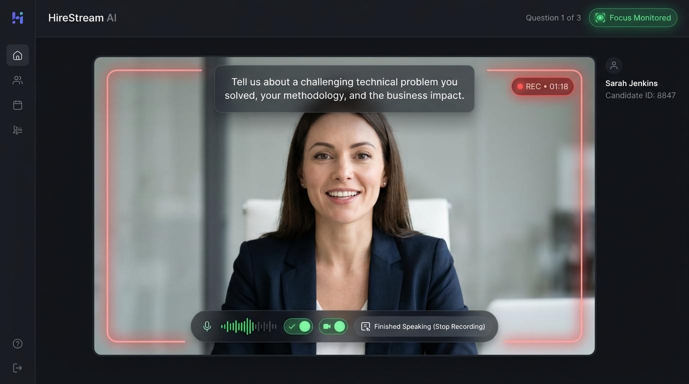
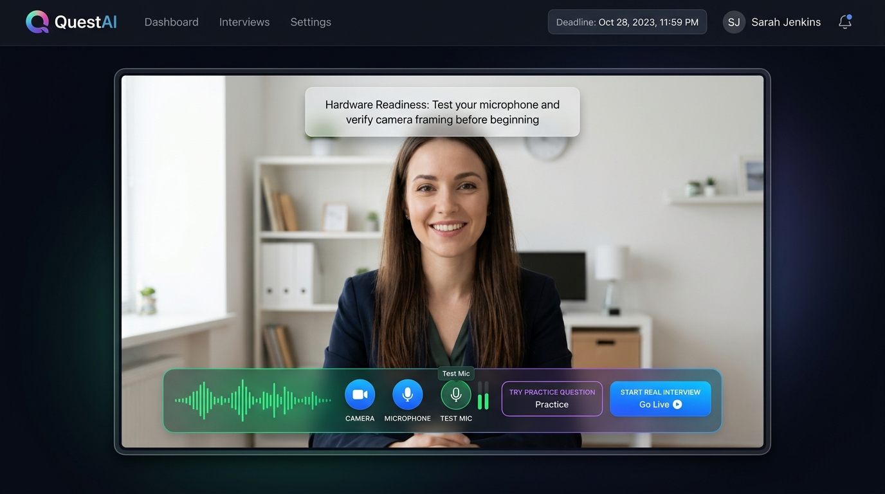

# Implemented: Center-Stage Immersive Video Studio (Built & Active)

## Status: Built & Verified in Production
This design has been implemented in the application with:
- **Full-size centered video frame** taking center stage.
- **The interview question positioned at the bottom**, directly above the audio meter and control buttons.
- **All action buttons** (Mic visualizer, Camera/Mic toggles, Action CTA) docked at the **bottom-center**.
- Zero vertical scrolling on standard laptop displays.

---

### Key Advantages of This Layout:
1. **Natural Eye Contact with Camera**:
   - In traditional split layouts, candidates look over to the left side to read the question and click buttons, which makes them look away from the camera.
   - In this **Center-Stage HUD Layout**, the question card floats at the top-center directly below the laptop's physical webcam lens. Reading the question naturally maintains direct eye contact with the interviewer!
2. **Ergonomic Bottom-Center Action Dock**:
   - The microphone meter, camera & mic toggle buttons, countdown timer, and primary action button (`Start Answering Now`, `Finished Speaking`, `Next Question →`) are consolidated into a centered floating glass dock.
   - The candidate's cursor and attention stay right in the center—zero neck or eye strain, and no glancing sideways.
3. **Maximizes Video Quality and Framing**:
   - The camera preview is enlarged to a dominant 16:9 cinematic studio aspect, framed with soft glowing phase borders (Pulsing Red for `REC`, Pulsing Blue for `AI Voice`, Amber for `Prep`).
4. **100% Zero-Scroll Guarantee**:
   - Perfectly scaled to fit standard laptop viewports (1366×768 and 1080p) without any vertical scrollbars.

---

## 1. Live Recording Studio (Question on Top, Controls at Bottom Center)

The interview question floats in a frosted dark glass card at eye-level, with the pulsing **REC** badge at top-right. The bottom dock houses the real-time audio visualizer, toggle pills, and the prominent **"Finished Speaking (Stop Recording)"** button:

---

## 2. Hardware Setup & Audio Verification (Center Stage)

During the setup/preview phase, the candidate sees their framed camera in the center, with instructions at top-center and an interactive verification dock at bottom-center (**Mic Visualizer**, **Camera/Mic Toggles**, **Test Mic**, **Try Practice Question**, and **Start Real Interview**):

---

## Candidate Journey Breakdown

| Step | What the Candidate Sees | Where It Is Located |
| :--- | :--- | :--- |
| **1. Job Overview** | Full Job Description, Target Skill Chips, Assessment Rules, Deadline Banner | Clean Welcome Page (Screen 1) |
| **2. Camera Setup** | Full 16:9 Center Preview + Framing Tips + Audio Meter + Test Mic / Test Speaker | Center Stage + Bottom Dock |
| **3. AI Reading Prompt** | Question text in top frosted HUD + AI Voice speaking animation | Top Center of Video Frame |
| **4. Prep / Think Time** | Question in top HUD + Prep Countdown (`28s`) + "Start Answering Now" button | Center Bottom Dock |
| **5. Recording Answer** | Question in top HUD + Glowing Red Frame + REC timer + "Finished Speaking" | Center Bottom Dock |
| **6. Submit / Next** | Response Captured badge + "Next Question (2 of 3) →" button | Center Bottom Dock |
